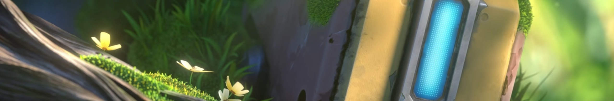
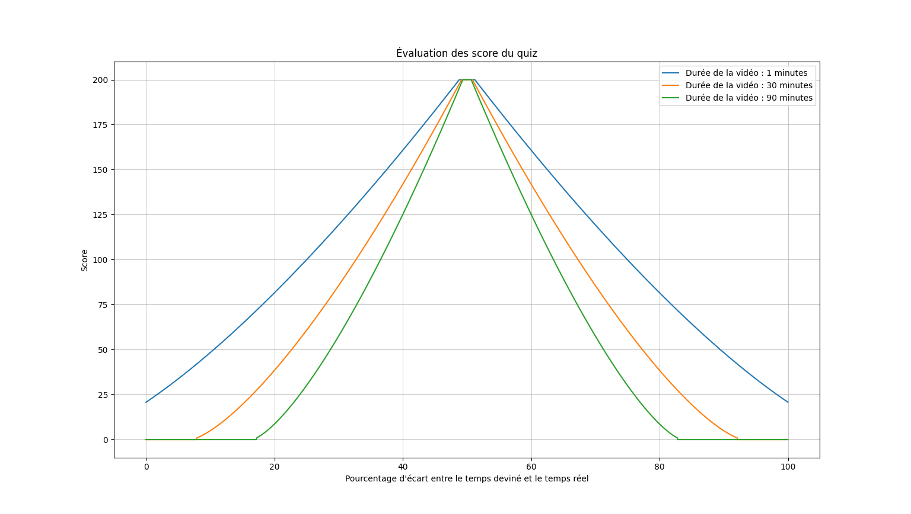
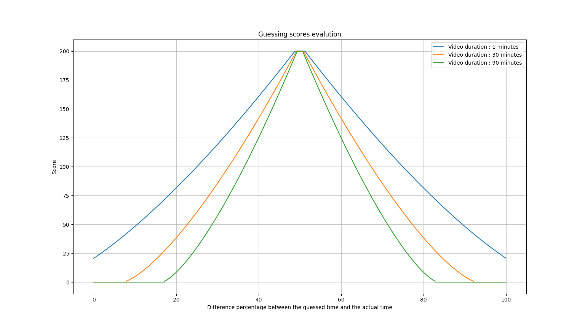

<!-- 
---
layout: default
title: Documentation
--- 
-->

# TheGreatGuess

[Français](#français)

[English](#english)

[Avancement des transcripts](#avancement-des-transcripts)

## Français

### Présentation

Ce projet est un quiz pour tester les connaissances du texte prononcé dans certaines vidéos. Les vidéos sélectionnées par défaut viennent de la chaine principale de **TheGreatReview**. Le principe du projet est de montrer à l'utilisateur un extrait textuel de la vidéo, et de le laisser identifier la vidéo dont l'extrait provient. Ensuite, si l'utilisateur a **guess** la bonne vidéo, il a l'occasion d'essayer de deviner le moment dans la vidéo d'où l'extrait a été tiré, récupérant des points en fonction d'à quel point il est proche de sa cible. Le quiz est voulu comme étant difficile, réussir à obtenir plus de la moitié des points du premier coup est remarquable. Il est déraisonnable de viser un score parfait, car les sous-titres peuvent parfois induire des erreurs (surtout les sous-titres français, venant de la transcription automatique de YouTube). Le score médian des utilisateurs du site est entre 2000 et 2500 points sur 6000, ceci dit, une performance servant de cible raisonnablement atteignable avec de l'entrainement serait d'obtenir 50% des points (3000/6000 points sur 15 questions).

### Sélection de vidéos

Sur la barre verticale à gauche de l'écran (ou en haut sur mobile), avant de commencer la partie, vous pouvez sélectionner les vidéos sur lesquelles vous voulez voir des extraits ou pas, afin d'éviter les spoils potentiels, avec le bouton en forme de croix. Vous pouvez réintégrer ces vidéos en allant tout en bas de la barre verticale, où les vidéos non sélectionnées sont grisées, et où vous pouvez les réintégrer aux vidéos possiblement tirées en appuyant sur le bouton en forme de +.

### Paramètres

Avant de commencer une partie (à la première manche avant de valider un titre), vous avez accès aux paramètres, qui vous permettent de changer : 

- [La langue](#langue)

- [Le nombre de manches](#manches)

- [Le thème](#thème)

- [Les titres vides](#autoriser-les-titres-vides)

- [Les transcripts automatiques](#autoriser-les-transcripts-automatiques)

- [L'aperçu du temps saisi](#aperçu-du-temps-saisi)

- [La difficulté](#difficulté)

#### Langue

Les langues disponibles sont le français et l'anglais, et changent la langue des extraits pouvant être sélectionnés. En anglais, seules certaines vidéos disposent de transcripts (qui ont tous été rédigés manuellement), les autres vidéos sont donc indisponibles dans cette langue. En français, toutes les vidéos sont disponibles, mais [la majorité](#transcripts-français) de leurs transcripts ont été générés automatiquement par YouTube, et sont donc de qualité questionnable. Du travail est en cours pour rédiger des transcripts adaptés dans les vidéos manquantes.

#### Manches

Vous avez le choix entre jouer 5, 15, 30, ou un nombre infini de manches. Le mode par défaut est 15 manches, qui correspond à une partie de taille normale. L'intérêt de choisir un nombre infini de manches peut être simplement l'entrainement sans se soucier des points, comme un mode d'entrainement, alors que les 3 autres servent plus à faire des parties plus ou moins longues selon le feeling. Un record avec un certain nombre de manches ne se transmet pas dans une partie avec un autre nombre de manches.

#### Thème

Il est possible de changer de thème (de clair à obscur) dans les paramètres lorsqu'ils sont ouverts, puis grâce au bouton qui les remplacent quand ils ne sont plus disponibles. Attention aux yeux en mode clair. 

#### Autoriser les titres vides

Un paramètre se sauvegardant entre les parties qui permet de mettre une erreur ou non quand vous essayez de valider un titre de vidéo sans avoir entré un titre de vidéo, ce qui sera donc une mauvaise réponse. Vous devriez l'activer si vous préférez pouvoir abandonner une question facilement, et le désactiver si vous êtes persistant.e et pensez qu'il est plus probable que ça vous fasse valider un titre par accident.

#### Autoriser les transcripts automatiques

Un paramètre limitant le nombre de vidéos pouvant être séléctionnées pour les choix d'extraits, afin de n'autoriser que les vidéos dont les transcripts ont été rédigés manuellement, et étant donc de bonne qualité. Cela peut limiter grandement le nombre de vidéos disponibles.

#### Aperçu du temps saisi

Un paramètre permettant d'activer ou de désactiver l'aperçu du temps interprété par le site lorsque vous tapez quelque chose au moment d'écrire un texte, afin de ne pas faire de fautes bêtes, mais qu'il ne dérange pas la vue en restant toujours présent même après familiarisation avec le site. Cette option est également désactivable avec un bouton en croix à côté de l'aperçu quand il apparaît.

#### Difficulté

Il est possible de changer de difficulté, ce qui revient à modifier les aides disponibles : Le mode normal, par défaut, permet d'utiliser les raccourcis (ow2= le DLC d'Outer Wilds) et une souplesse pour taper le titre, d'avoir accès à la barre latérale, à des extraits complets, et aux suggestions. Il existe aussi le mode difficile, qui interdit les raccourcis et désactive la barre latérale, et le mode hardcore, qui désactive également les suggestions. Peut-être qu'il serait intéressant d'avoir un mode désactivant les extraits étendus, qui sait ?

### Vidéo

Une phrase s'affichera à l'écran : il s'agira d'un extrait vidéo, ou d'une traduction de cet extrait. Dans les deux cas, votre objectif sera de retrouver le titre de la vidéo d'origine. Si le titre ne vous vient pas à l'esprit, essayez d'entrer des mots-clés thématiques de la vidéo, il est probable qu'elle vous soit suggérée. Si vous trouvez la bonne vidéo, vous recevrez 200 points et aurez l'occasion de *guess* à quel moment de la vidéo la phrase affichée a été prononcée.

### Bonne réponse

Si vous avez trouvé la bonne vidéo, vous obtiendrez un peu plus de contexte et serez invité à *guess* à quel moment de la vidéo l'extrait a été prononcé.
Vous pouvez saisir l'heure sous les formats `XX:XX:XX` ou `XXhXXmXXs`. Par défaut, la saisie correspond aux minutes, puis aux heures, et aux secondes (par exemple, `1:2` correspond à 1 heure 02 minutes, `25` correspond à 25 minutes). La casse (majuscules/minuscules), les espaces, et les accents ne sont pas pris en compte.

Après avoir fait votre *guess*, un score vous sera attribué en fonction de votre proximité au temps exact. Vous pourrez gagner jusqu'à 200 points en trouvant le moment précis. À titre indicatif, il est possible de marquer des points sur environ 50 % de la durée totale de la vidéo (la durée vous sera indiquée), et le calcul suit une augmentation quadratique (un écart d'une minute entraîne une variation de points plus importante lorsque vous êtes proche de la cible).

### Mauvaise réponse

Si vous avez *guess* la mauvaise vidéo, la séquence vidéo qui était à trouver vous sera présentée à partir du moment correspondant au texte affiché, afin que vous puissiez vous souvenir de la scène.

### Résumé

À la fin de la partie, un résumé s'affiche vous permettant de reprendre vos erreurs, de les comprendre, et de ré-évaluer votre partie. Ce résumé comprend vos entrées ainsi que les entrées attendues. Si c'est votre première partie, le score que vous avez obtenu sera enregistré comme votre record dans ce mode. 

### Avancé

Si vous avez des idées d'amélioration ou si vous constatez des comportements sur le site qui vous semblent indésirés, je vous invite à me contacter sur [Discord](https://discord.com/users/545300661302984714) ou à ouvrir une [issue](https://github.com/HRLupa/TheGreatGuess/issues) pour m'en informer, afin que je puisse faire la mise à jour.

## English

### Presentation

This project is a quiz to test knowledge on the structure of chosen videos. The default are the videos from **TheGreatReview**'s main channel. The idea is to show a few lines that were said during the videos and for the user to try to identify which video the extract is from. Then, if the video is **guessed** correctly, the user should try to estimate when the extract has been pronounced in the video, rewarding them with points regarding how close they were to the actual timecode. It's supposed to be a hard quiz, getting above half the points is pretty remarkable. Getting a perfect score is close to impossible, as the subtitles are not always perfect (especially the French ones, which come from YouTube's automatic transcription). The median score of TheGreatGuess' players is between 2000 and 2500 points out of 6000. That being said, a reasonable target you can aim for is about 50% of the points (3000/6000 points for 15 questions).

### Selecting Videos

On the vertical sidebar on the left side of the screen (or at the top on mobile), before starting a game, you can choose which videos you would like to include or exclude, helping you avoid potential spoilers, by using the "X" button. You can add previously excluded videos back into the pool by scrolling to the bottom of the sidebar, where deselected videos appear in gray; then, click the "+" button to include them again.

### Settings

Before starting a game (during the first round, before confirming a title), you can access the settings menu to adjust the following:

- [Language](#language)

- [Number of rounds](#rounds)

- [Theme](#theme)

- [Empty titles](#allow-empty-titles)

- [Automatic transcripts](#allow-automatic-transcripts)

- [Input timing preview](#input-timing-preview)

- [Difficulty](#difficulty)

#### Language

You can choose between French and English, which determines the language of the video extracts that the game will choose from. In English, only certain videos have transcripts (all of which were written manually), as YouTube does not automatically provide translated subtitles in English; therefore, videos without such transcripts are unavailable in this language. In French, all videos are available, though [most](#french-transcripts) of the transcripts were automatically generated by YouTube and may be of questionable quality. Work is currently underway to create proper, accurate transcripts for the videos that are currently lacking them.

#### Rounds

You can choose to play 5, 15, 30, or an infinite amount of rounds. The default setting is 15 rounds, which constitutes a standard-length game. Choosing an infinite number of rounds can be useful for practice—essentially a "training mode"—where you don't have to worry about your score. The other three options allow you to play games of varying lengths, depending on your preference. Records set for a specific number of rounds do not carry over to games with a different number of rounds.

#### Theme

You can switch between themes (light or dark) via the settings menu. Once the menu is closed, the option remains accessible through a button that appears in its place. Be careful with your eyes when using the light theme!

#### Allow Empty Titles

This setting, which persists between games, determines whether an error is triggered if you attempt to submit a video title without having entered anything (which counts as an incorrect answer). You might want to enable this if you prefer the ability to easily "give up" on a question; conversely, if you are persistent, you might want to disable it to avoid accidentally submitting an empty title.

#### Allow Automatic Transcripts

This setting filters the pool of available videos, restricting it to those with manually written (and therefore high-quality) transcripts. Enabling this may significantly reduce the number of videos available for selection.

#### Input Timing Preview

This feature displays how the site interprets the time you enter when typing. It helps prevent simple mistakes, but you can disable it if you find it distracting—especially once you’ve become familiar with the site. You can also dismiss the preview by clicking the "X" button that appears next to it. 

#### Difficulty

You can change the difficulty level, which essentially adjusts the available aids: Normal mode—the default—allows for the use of shortcuts (e.g., "ow2" for the *Outer Wilds* DLC), offers some flexibility when typing titles, and provides access to a sidebar, full excerpts, and suggestions. There is also Hard mode, which prohibits shortcuts and disables the sidebar, as well as Hardcore mode, which additionally disables suggestions. Perhaps it would be interesting to have a mode that disables extended excerpts—who knows?

### Video

A phrase will appear on the screen: this will be either a transcription of a clip of a video, or a translation of that clip. In either case, your goal is to identify the title of the original video. If the title doesn't come to mind, try entering keywords related to the video's theme : the video's title will likely be suggested to you. If you find the correct video, you will receive 200 points and get the chance to guess at what point in the video the displayed phrase was spoken.

### Correct Answer

If you find the correct video, you will get a bit more context and be asked to *guess* at what point in the video the clip was spoken.
You can enter the time in formats such as `XX:XX:XX` or `XXhXXmXXs`. By default, the input corresponds to minutes, then hours, and then seconds (for example, `1:2` corresponds to 1 hour and 2 minutes, and `25` corresponds to 25 minutes). The input is insensitive to case, spaces, and accents.

After making your guess, you will be awarded a score based on how close you were to the exact time. You can earn up to 200 points by finding the exact time. As a guide, you can score points within a range covering about 50% of the video's total duration (the duration will be displayed), and the calculation follows a quadratic curve (a one-minute difference results in a larger point variation when you're close to the target).

### Incorrect Guess

If you guess an incorrect video, a clip showing the target video will be shown to you starting at the moment corresponding to the displayed text, helping you recall the scene for the next time.

### State of transcriptions

Some transcriptions come from manual transcripts from the video, which are great and of quality, while some others come from the automatic YouTube retranscription, and are not adaptated to the website. I am working on adding more manual transcripts on French language, but will leave the English ones untouched, out of respect towards TheGreatReview who wanted translators who were speaking English natively so that they could replicate his tone in a good way, which I am not capable of. However, I am working on French subtitles, to provide a gameplay of better quality, while still being accurate, as I don't have to translate anything. Here's the current state of the manual/automatic subtitles

### Advanced

If you have ideas for improvement or notice any unexpected behavior on the site, please contact me on [Discord](https://discord.com/users/545300661302984714) or open an [issue](https://github.com/HRLupa/TheGreatGuess/issues) to let me know so I can make updates.

## Avancement des transcripts

### Transcripts français

#### Manuels

- La géopolitique expliquée avec des pixels
- Tunic : Le jeu qui en cachait un autre
- 22 minutes pour sauver l'univers (ok un peu plus)

#### Automatiques

- Un noob sur csgo
- Dark souls : comment utiliser la verticalité pour construire une carte
- Haikyuu! Quand le volley, c'est vraiment toute ta vie.
- Made in abyss : Review
- HITMAN
- L'ère des cristaux - Review
- Frostpunk : il fait beau demain ?
- Pourquoi Ghost Recon fait péter un plomb ?
- Fallen Order manque d'ambition
- Tous les boss de Dark Souls 3 d'affilée sans mourir
- Subnautica
- Dead By Daylight et la dissonance ludonarrative.
- Leçon de mise en scène avec Doom Eternal
- L'incroyable histoire d'Otzdarva et de la run Dark Souls la plus difficile
- La quête du dernier secret
- Comment Among Us a explosé
- La plus grande partie de capture de drapeau de l'histoire d'Internet
- Les clubs du futur
- Le mystère du 8
- C'est quoi un bon film ?
- Qu'est-ce que le cinéma a appris au jeu vidéo ?
- La plus belle des équipes
- Créer (et détruire) la plus grosse licence d'Occident
- La légende de Barbe Scintillante
- 22 minutes de + pour comprendre l'univers
- Le jeu où on plante des sapins
- Quand 500 jeunes ont tenu une montagne contre les nazis
- Mais pourquoi Nintendo porte plainte contre tout le monde ?
- \"Ce n'est pas de l'esport, c'est la FGC\"
- Bloqués 5 heures sur Age of Empires

### English transcripts

#### Manual

- The incredible story of Otzdarva and the hardest Dark Souls run
- The last big Secret
- How Among Us made it
- Greatest game of capture the flag ever played
- Geopolitics explained through pixels
- Gaming teams of the future
- Le mystère du 8
- Tunic : Le jeu qui en cachait un autre
- C'est quoi un bon film ?
- Qu'est-ce que le cinéma a appris au jeu vidéo ?
- 22 minutes pour sauver l'univers (ok un peu plus)
- La plus belle des équipes
- Créer (et détruire) la plus grosse licence d'Occident
- La légende de Barbe Scintillante
- 22 minutes de + pour comprendre l'univers
- Le jeu où on plante des sapins
- Quand 500 jeunes ont tenu une montagne contre les nazis

#### Automatic

- Bloqués 5 heures sur Age of Empires
- It's not esports, it's the FGC